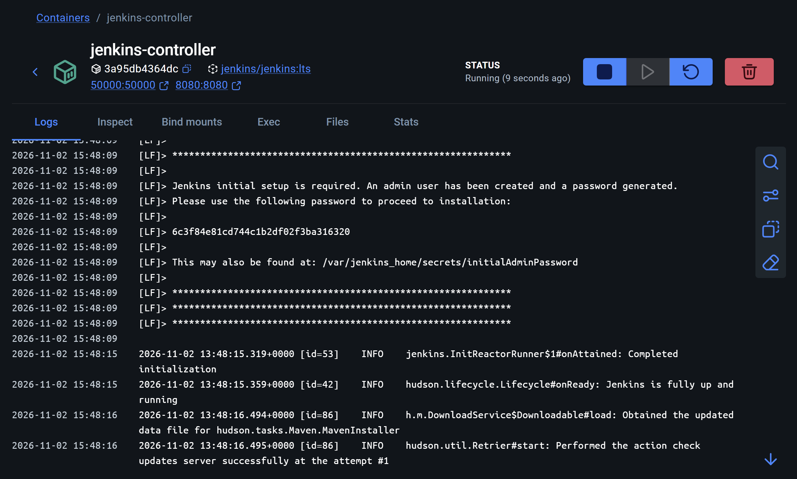
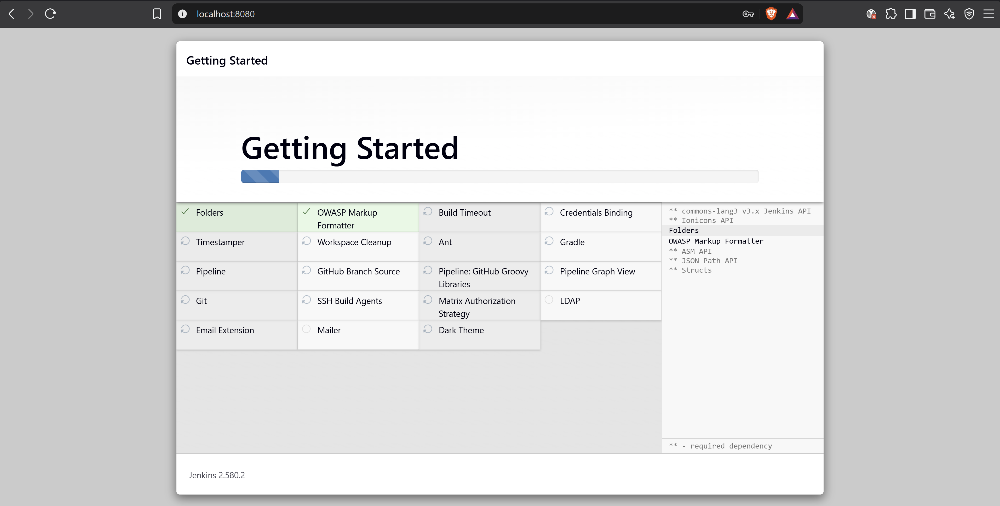
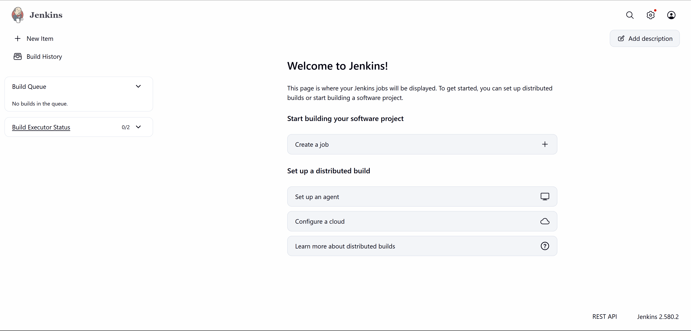
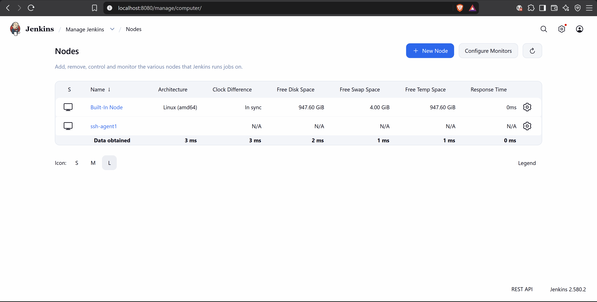
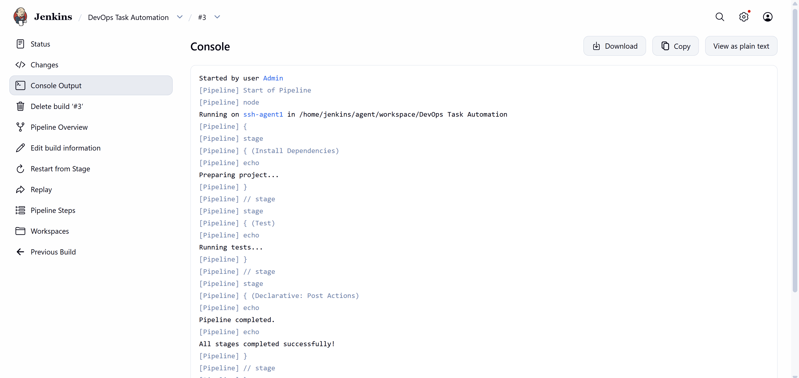
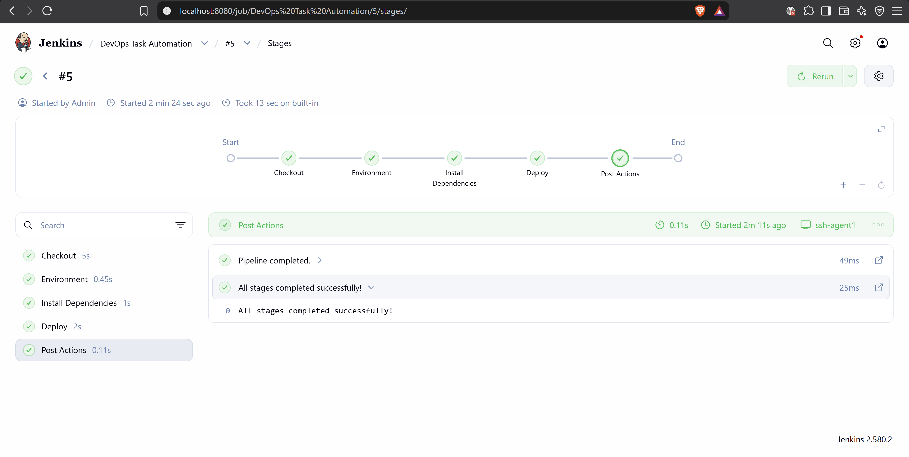

# Lab #4 — Jenkins CI/CD for a PHP application

## Project description

The goal of this lab is to configure Jenkins for DevOps task automation and to build a CI/CD pipeline that runs on a separate SSH agent.

The application used in the pipeline is the **Expense Tracker** from [`gausatereduard/php-lab8`](https://github.com/gausatereduard/php-lab8). It is a PHP 8 application that stores expenses in SQLite through PDO and renders the interface with both native PHP templates and Twig. The application supports listing, creating, editing, and deleting expenses, as well as grouping them by category.

The lab environment consists of two containers:

- `jenkins-controller` — Jenkins controller, available at <http://localhost:8080>;
- `ssh-agent` — Jenkins SSH build agent with PHP, Composer, and the required PHP extensions.

The pipeline checks out the PHP project, installs its Composer dependencies, and starts the application on port `8000`. The running application is available at:

- <http://localhost:8000/index.php> — native PHP templates;
- <http://localhost:8000/index_twig.php> — Twig templates.

## Repository structure

| Path | Purpose |
| --- | --- |
| `docker-compose.yml` | Defines the Jenkins controller, the SSH agent, volumes, and the network. |
| `Dockerfile` | Builds the SSH agent image with PHP, PHP extensions, Composer, and Git. |
| `.env` | Contains the public SSH key used by the agent. Not committed to Git. |
| `.env.example` | Example of the required environment variable. |
| `secrets/` | SSH key pair used by Jenkins to connect to the agent. Not committed to Git. |
| Jenkins job config | Declarative pipeline used by the `DevOps Task Automation` job; reproduced in the appendix. |
| `assets/` | Screenshots of the completed lab. |
| `README.md` | This report. |

## Architecture

```text
Browser
   │
   ├── http://localhost:8080  ──> jenkins-controller
   │                                  │
   │                                  │ SSH (port 22, Docker network)
   │                                  ▼
   └── http://localhost:8000  ──> ssh-agent
                                      │
                                      └── php -S 0.0.0.0:8000
```

Jenkins connects to the agent over SSH inside the Docker network. The PHP application runs on the agent, and port `8000` is published to the host so the application can be opened in a browser.

## 1. Setting up the Jenkins controller

The controller is defined in `docker-compose.yml`:

```yaml
services:
  jenkins-controller:
    image: jenkins/jenkins:lts
    container_name: jenkins-controller
    ports:
      - "8080:8080"
      - "50000:50000"
    volumes:
      - jenkins_home:/var/jenkins_home
    networks:
      - jenkins-network
```

Start it with:

```bash
docker compose up -d jenkins-controller
```

The initial administrator password is printed in the container log:

```bash
docker logs jenkins-controller
```

It can also be read directly from the container:

```bash
docker exec jenkins-controller cat /var/jenkins_home/secrets/initialAdminPassword
```



After opening <http://localhost:8080>, the initial setup wizard is completed: the suggested plugins are installed, and the administrator account is created.



The controller is then ready and shows the Jenkins dashboard.



The `jenkins_home` named volume keeps the Jenkins configuration, jobs, credentials, and build history between container restarts.

## 2. Setting up the SSH agent

SSH keys are generated in the `secrets` directory:

```bash
mkdir -p secrets
ssh-keygen -f secrets/jenkins_agent_ssh_key
```

The public key is added to `.env`:

```dotenv
JENKINS_AGENT_SSH_PUBKEY="ssh-ed25519 AAAA... user@host"
```

A `.env.example` file documents the expected variable:

```dotenv
JENKINS_AGENT_SSH_PUBKEY="algo key user@pc"
```

The agent image is built from `Dockerfile`:

```dockerfile
FROM composer:2 AS composer

FROM jenkins/ssh-agent

RUN apt-get update && apt-get install -y --no-install-recommends \
        php-cli \
        php-sqlite3 \
        php-mbstring \
        php-xml \
        php-zip \
        unzip \
        git \
        psmisc \
    && rm -rf /var/lib/apt/lists/*

COPY --from=composer /usr/bin/composer /usr/local/bin/composer
```

The PHP extensions are required by the selected project:

- `php-sqlite3` — SQLite/PDO support for the expense database;
- `php-mbstring` and `php-xml` — required by Twig and testing tools;
- `php-zip` and `unzip` — allow Composer to install packages from ZIP archives;
- `psmisc` — provides `fuser`, used by the deploy stage to free port `8000`.

The agent service is added to `docker-compose.yml`:

```yaml
  ssh-agent:
    build:
      context: .
      dockerfile: Dockerfile
    container_name: ssh-agent
    ports:
      - "8000:8000"
    environment:
      - JENKINS_AGENT_SSH_PUBKEY=${JENKINS_AGENT_SSH_PUBKEY}
    volumes:
      - jenkins_agent_volume:/home/jenkins/agent
    depends_on:
      - jenkins-controller
    networks:
      - jenkins-network
```

Port `8000` is published so the deployed PHP application can be opened from the host browser.

Build and start both services:

```bash
docker compose up -d --build
```

Verify that the containers are running:

```bash
docker compose ps
docker logs ssh-agent
```

## 3. Connecting the SSH agent to Jenkins

The **SSH Agents Plugin** must be installed in Jenkins. It is included in the suggested plugin set installed during the initial setup.

The agent credentials are added in:

**Manage Jenkins → Credentials → System → Global credentials → Add Credentials**

- Kind: `SSH Username with private key`;
- ID: `jenkins-ssh-agent`;
- Username: `jenkins`;
- Private key: the contents of `secrets/jenkins_agent_ssh_key`.

A permanent agent is then created in:

**Manage Jenkins → Nodes → New Node**

- Name: `ssh-agent1`;
- Type: `Permanent Agent`;
- Label: `php-agent`;
- Remote root directory: `/home/jenkins/agent`;
- Launch method: `Launch agents via SSH`;
- Host: `ssh-agent`;
- Port: `22`;
- Credentials: `jenkins-ssh-agent`.

The node is visible on the Jenkins nodes page after it is saved.



### SSH host key verification

The node uses the `KnownHostsFileKeyVerificationStrategy`, so Jenkins needs a `known_hosts` file at `/var/jenkins_home/.ssh/known_hosts`.

If the file is missing, the agent log shows repeated pre-authentication disconnects:

```text
Connection closed by 172.18.0.2 port ... [preauth]
```

and Jenkins reports the node as offline. The host key is added from inside the controller:

```bash
docker exec jenkins-controller sh -c "mkdir -p /var/jenkins_home/.ssh && ssh-keyscan -H ssh-agent > /var/jenkins_home/.ssh/known_hosts && chown -R jenkins:jenkins /var/jenkins_home/.ssh && chmod 700 /var/jenkins_home/.ssh"
docker restart jenkins-controller
```

After the restart, the agent connects and appears online in Jenkins.

> If the `ssh-agent` container is recreated, its SSH host keys are regenerated. Repeat the `ssh-keyscan` command and restart the controller, or use a non-verifying host key strategy for a disposable lab environment.

## 4. Creating and configuring the Jenkins pipeline

A Pipeline job named `DevOps Task Automation` is created in Jenkins. The job uses the `php-agent` label so every build runs on `ssh-agent1`.

The final pipeline contains four stages:

1. **Checkout** — clones `gausatereduard/php-lab8` into the `app` directory;
2. **Environment** — prints the PHP version, loaded PHP modules, and Composer version;
3. **Install Dependencies** — runs `composer install`;
4. **Deploy** — stops the previous PHP server, starts a new one on `0.0.0.0:8000`, and verifies that `index.php` returns the application page.

The pipeline script is stored in the Jenkins job and is reproduced in the [appendix](#appendix-final-pipeline-script).

An early version of the pipeline, using the placeholder `Test` stage from the assignment template, ran successfully on the agent and confirmed that remote pipeline execution works.



The final pipeline adds the real project checkout, dependency installation, and deployment. Build `#5` completed all stages successfully.



## 5. Running and verifying the application

After a successful pipeline run, the application is started by the deploy stage inside the `ssh-agent` container:

```text
Application is running at http://localhost:8000
```

Open the application in a browser:

- native templates: <http://localhost:8000/index.php>
- Twig templates: <http://localhost:8000/index_twig.php>

The deploy stage keeps the PHP server alive after the Jenkins build because it is started with `nohup` and with `BUILD_ID` / `JENKINS_NODE_COOKIE` set to `dontKillMe`. This prevents Jenkins from terminating the server when the build finishes.

Useful commands for checking the deployed application:

```bash
# Check that the server is listening
docker exec ssh-agent fuser 8000/tcp

# Show the PHP server log
docker exec ssh-agent cat /tmp/php-lab8-server.log

# Restart the deployment by running the Jenkins job again
```

Each new pipeline run replaces the running server with the freshly checked-out version of the project.

### About automated tests

The upstream `php-lab8` repository does not contain a PHPUnit test suite. For that reason, the final pipeline verifies the project by installing its dependencies, starting it, and checking that the application page is rendered successfully. If a `tests/` directory and `vendor/bin/phpunit` are added to the project later, a test stage can be added with:

```groovy
stage('Test') {
    steps {
        dir('app') {
            sh 'vendor/bin/phpunit'
        }
    }
}
```

## 6. Answers to the control questions

### 6.1 What are the advantages of using Jenkins for DevOps task automation?

- **Open source and self-hosted** — the whole CI/CD environment can run locally or on controlled infrastructure.
- **Large plugin ecosystem** — integrations exist for Git, GitHub, Docker, SSH agents, credentials, notifications, and many other tools.
- **Pipeline as code** — the build process is stored in a `Jenkinsfile` and can be versioned together with the application.
- **Distributed builds** — jobs can run on multiple agents with different environments and labels.
- **Reproducible automation** — the same build, test, and deploy steps are executed for every change, reducing manual errors.
- **Fast feedback** — failed builds and tests are detected early, before changes reach production.
- **Extensibility** — custom stages, shared libraries, and plugins allow Jenkins to fit many project types.
- **Build history and reporting** — Jenkins stores console output, test results, artifacts, and stage timings.

### 6.2 What other types of Jenkins agents exist?

Besides a permanent SSH agent like `ssh-agent1`, Jenkins supports:

- **Built-in node** — the controller itself can run builds, although this is not recommended for production.
- **Permanent agents** — long-running machines connected over SSH or JNLP/WebSocket.
- **Inbound agents** — agents that initiate the connection to the controller using the remoting jar.
- **Docker agents** — ephemeral containers started for a build and removed afterward.
- **Kubernetes agents** — pods created dynamically in a Kubernetes cluster.
- **Cloud agents** — virtual machines provisioned on demand, for example on AWS, Azure, or Google Cloud.
- **Platform-specific agents** — Windows, Linux, and macOS machines for builds that require a particular operating system.
- **Swarm agents** — lightweight agents that join automatically through the Swarm plugin.

### 6.3 What problems were encountered and how were they solved?

1. **The SSH agent was online in Docker but offline in Jenkins.**

   The agent log showed `Connection closed by ... [preauth]`. Jenkins was using `KnownHostsFileKeyVerificationStrategy`, but `/var/jenkins_home/.ssh/known_hosts` did not exist. The host key was added with `ssh-keyscan` and Jenkins was restarted. The agent then connected successfully.

2. **The agent image did not contain Composer or the required PHP extensions.**

   The original `jenkins/ssh-agent` image only had PHP CLI. Installing dependencies from the pipeline was unreliable because the build user had no root access. The `Dockerfile` was changed to install `php-sqlite3`, `php-mbstring`, `php-xml`, `php-zip`, `unzip`, and `git`, and to copy Composer from the official `composer:2` image.

3. **The deployed application was not reachable from the host browser.**

   PHP was listening inside the `ssh-agent` container, but the port was not published. Port `8000:8000` was added to the `ssh-agent` service in `docker-compose.yml`.

4. **The PHP server was stopped when the Jenkins build finished.**

   Jenkins normally terminates processes left by a build. The server is now started with `nohup` and with `BUILD_ID=dontKillMe` and `JENKINS_NODE_COOKIE=dontKillMe`, so it remains available after the pipeline completes.

5. **The old PHP server blocked the port on the next deployment.**

   The deploy stage uses `fuser -k 8000/tcp` before starting a new server. This makes every pipeline run replace the previous deployment cleanly.

## 7. Conclusion

The lab demonstrated a complete Jenkins setup with a controller, a separate SSH build agent, and a declarative pipeline for a real PHP application. The pipeline checks out the project, installs its dependencies, and deploys it so the result can be inspected in a browser. The main integration issues — SSH host key verification, missing PHP extensions, port publishing, and process lifetime — were identified and resolved.

## Submission

Repository: <https://github.com/gausatereduard/automation/tree/main/lab04>

Application repository used by the pipeline: <https://github.com/gausatereduard/php-lab8>

---

## Appendix: final pipeline script

```groovy
pipeline {
    agent {
        label 'php-agent'
    }

    stages {
        stage('Checkout') {
            steps {
                dir('app') {
                    deleteDir()
                    git branch: 'main', url: 'https://github.com/gausatereduard/php-lab8.git'
                }
            }
        }

        stage('Environment') {
            steps {
                sh '''
                    php -v
                    php -m | sort
                    composer --version
                '''
            }
        }

        stage('Install Dependencies') {
            steps {
                dir('app') {
                    sh '''
                        set -e
                        composer install --no-interaction --prefer-dist --no-progress
                    '''
                }
            }
        }

        stage('Deploy') {
            steps {
                dir('app') {
                    sh '''
                        set -e

                        # Stop the previous deployment, if any
                        if command -v fuser >/dev/null 2>&1; then
                            fuser -k 8000/tcp >/dev/null 2>&1 || true
                        fi

                        # Start PHP and keep it alive after the build finishes
                        BUILD_ID=dontKillMe JENKINS_NODE_COOKIE=dontKillMe nohup php -S 0.0.0.0:8000 > /tmp/php-lab8-server.log 2>&1 &
                        echo $! > /tmp/php-lab8.pid

                        sleep 2

                        php -r '
                            $html = @file_get_contents("http://127.0.0.1:8000/index.php");
                            if ($html === false || strpos($html, "Список расходов") === false) {
                                fwrite(STDERR, "Deployment check failed" . PHP_EOL);
                                exit(1);
                            }
                            echo "Application is running at http://localhost:8000" . PHP_EOL;
                        '
                    '''
                }
            }
        }
    }

    post {
        always {
            echo 'Pipeline completed.'
        }
        success {
            echo 'All stages completed successfully!'
        }
        failure {
            echo 'Errors detected in the pipeline. Check the stage log above.'
        }
    }
}
```
