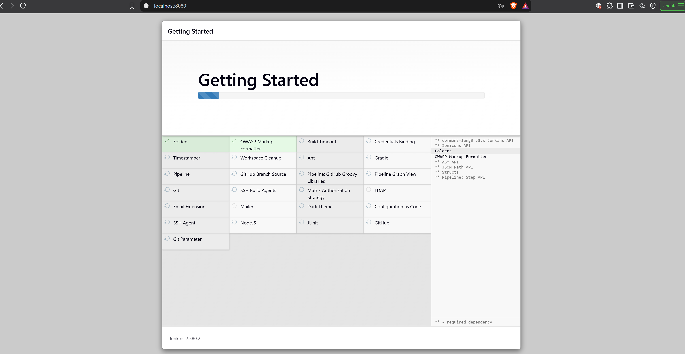
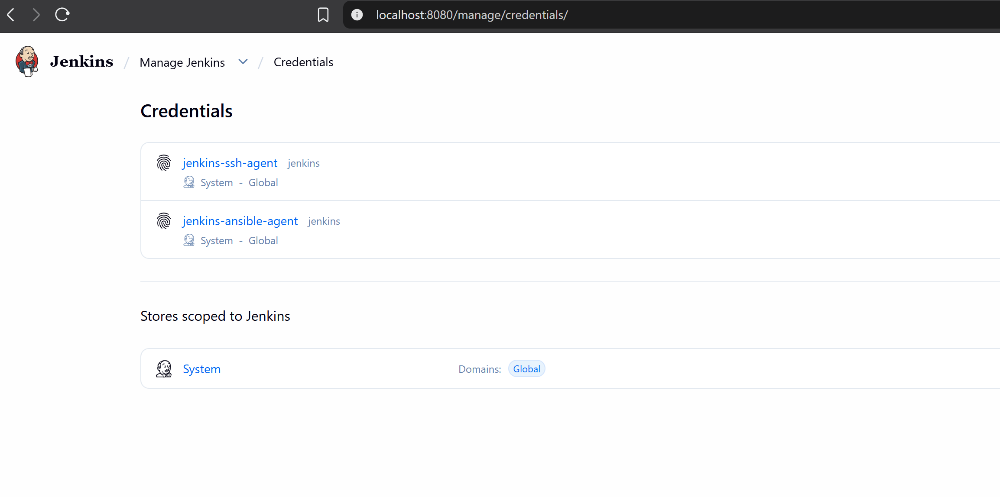
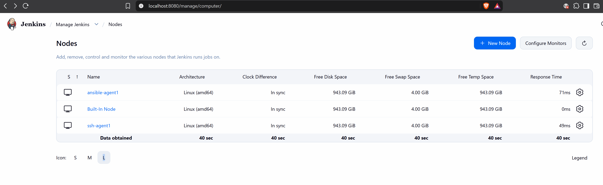
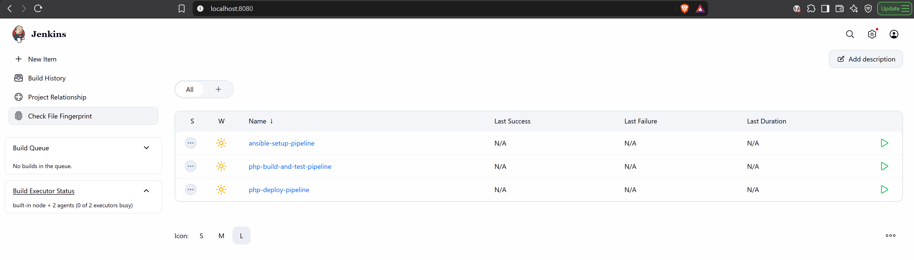
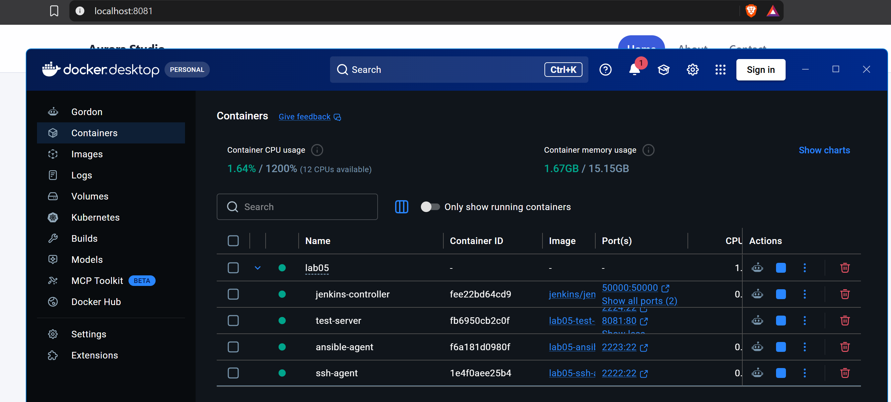

# Lab #5 — Automating server configuration with Ansible

This is my individual work **IW05** for the *Automation and Scripting* course. I used Ansible to
configure an Ubuntu test server and connected that step to Jenkins pipelines. The deployed
application is a small static PHP site, available at <http://localhost:8081/>.

| Service | Image / Dockerfile | Purpose | Host port |
| --- | --- | --- | --- |
| `jenkins-controller` | `jenkins/jenkins:lts` | Jenkins web UI and jobs | `8080` |
| `ssh-agent` | `Dockerfile.ssh_agent` | Builds and tests the PHP site | `2222` |
| `ansible-agent` | `Dockerfile.ansible_agent` | Runs the Ansible playbooks | `2223` |
| `test-server` | `Dockerfile.test_server` | Ubuntu server configured by Ansible | `8081` |

I run the pipelines in this order: **build and test → configure test server → deploy**.

> This is a disposable university lab. Host key checking is disabled only for the test server;
> `secrets/` and `.env` are excluded from Git.

**Quick start:** generate the keys (section 2), run `docker compose up -d --build`, configure
Jenkins (sections 1–3), then run the three jobs (section 6).

## 1. Jenkins controller

I generated the keys first (section 2) and filled `.env`, then started the stack:

```bash
docker compose up -d --build
docker exec jenkins-controller cat /var/jenkins_home/secrets/initialAdminPassword
```

I opened <http://localhost:8080>, completed the setup wizard and installed these plugins:

- Docker
- Docker Pipeline
- GitHub Integration
- SSH Agent
- JUnit



## 2. SSH agent

I generated three key pairs and put the public keys into `.env` (format in `.env.example`):

```bash
mkdir -p secrets
ssh-keygen -t ed25519 -N "" -C "jenkins -> ssh-agent"      -f secrets/jenkins_ssh_agent_key
ssh-keygen -t ed25519 -N "" -C "jenkins -> ansible-agent"  -f secrets/jenkins_ansible_agent_key
ssh-keygen -t ed25519 -N "" -C "ansible -> test-server"    -f secrets/ansible_test_server_key
```

`Dockerfile.ssh_agent` extends `jenkins/ssh-agent` with PHP CLI, Composer, Git and the PHP
extensions that PHPUnit needs. I added the credential and the node in Jenkins:

| Credential | Username | Private key |
| --- | --- | --- |
| `jenkins-ssh-agent` | `jenkins` | `secrets/jenkins_ssh_agent_key` |

Node `ssh-agent1`: label `php-agent`, host `ssh-agent`, root `/home/jenkins/agent`, launch method
**Launch agents via SSH**, credential `jenkins-ssh-agent`.

## 3. Ansible agent

`Dockerfile.ansible_agent` is based on Ubuntu 24.04 and installs Ansible, OpenSSH, JDK 21 and rsync.
Its entrypoint installs the Jenkins public key and copies the test-server key from the Compose
secret to `/home/jenkins/.ssh/id_test_server` with mode `0600`.

I added the second credential and node:

| Credential | Username | Private key |
| --- | --- | --- |
| `jenkins-ansible-agent` | `jenkins` | `secrets/jenkins_ansible_agent_key` |



Node `ansible-agent1`: label `ansible-agent`, host `ansible-agent`, root `/home/jenkins/agent`,
launch method **Launch agents via SSH**, credential `jenkins-ansible-agent`.

Then I seeded the agent host keys, otherwise the nodes stay offline:

```bash
docker exec jenkins-controller sh -c "
  mkdir -p /var/jenkins_home/.ssh
  ssh-keyscan -H ssh-agent ansible-agent >> /var/jenkins_home/.ssh/known_hosts
  chown -R jenkins:jenkins /var/jenkins_home/.ssh
  chmod 700 /var/jenkins_home/.ssh
"
```



## 4. Test server

`Dockerfile.test_server` installs only `openssh-server`, Python, rsync and a passwordless-sudo
`ansible` user. Apache and PHP are **not** in the image: the playbook installs them. Port `80` is
published as `8081`.

## 5. Ansible playbooks

`ansible/hosts.ini` describes the only managed host:

```ini
[test_servers]
test-server ansible_host=test-server ansible_user=ansible ansible_ssh_private_key_file=/home/jenkins/.ssh/id_test_server
```

`setup_test_server.yml`:

- updates apt and installs Apache2, `libapache2-mod-php` and the PHP extensions;
- deploys the virtual host template, enables `rewrite` and starts Apache;
- checks `http://127.0.0.1/` and restarts Apache only when the configuration changes.

`deploy_php_app.yml`:

- fails if Apache is missing, then copies the site to `/var/www/html`;
- fixes ownership, restarts Apache and checks the page over HTTP.

I can also run a playbook manually from the Ansible agent:

```bash
cd lab05
ansible-playbook -i ansible/hosts.ini ansible/setup_test_server.yml
ansible-playbook -i ansible/hosts.ini ansible/deploy_php_app.yml -e "project_dir=$PWD/app"
```

The first setup run reports `ok=9 changed=7 failed=0`; a second run reports `changed=0`, so the
playbook is idempotent. The deploy run reports `ok=7 changed=3 failed=0`.

## 6. Jenkins pipelines

I created three **Pipeline** jobs and pasted the matching script from `pipelines/`:

| Job | Pipeline script | Runs on |
| --- | --- | --- |
| `php-build-and-test-pipeline` | `php_build_and_test_pipeline.groovy` | `php-agent` |
| `ansible-setup-pipeline` | `ansible_setup_pipeline.groovy` | `ansible-agent` |
| `php-deploy-pipeline` | `php_deploy_pipeline.groovy` | `ansible-agent` |



The jobs have no automatic triggers, so after a push I run them manually with **Build with
Parameters** (default branch `main`), in the order above. The build job runs `composer install` and
PHPUnit and publishes the JUnit report; the setup job runs the setup playbook; the deploy job runs
the deploy playbook and checks the site with `curl`.

All three jobs finished with `SUCCESS` on build #1. PHPUnit reported
`OK (11 tests, 21 assertions)`, and the deploy smoke test returned HTTP 200 for every page.

## 7. Deployed site

After the deploy job, <http://localhost:8081/> serves the site (Apache 2.4.58 + PHP 8.3.6).



## 8. Control questions

### 8.1 Advantages of Ansible for server configuration

- **Agentless** — only SSH and Python are needed on the managed host.
- **Idempotent** — re-running a playbook changes nothing if the state is already correct.
- **Declarative and versionable** — YAML playbooks are readable and live in Git.
- **Push-based and reusable** — playbooks run when CI/CD invokes them; modules and roles avoid
  duplicated work.

### 8.2 Other Ansible modules

- Packages and services: `apt`, `dnf`, `package`, `pip`, `service`, `systemd`.
- Files: `copy`, `template`, `file`, `lineinfile`, `get_url`, `unarchive`.
- Users and scheduling: `user`, `group`, `authorized_key`, `cron`, `systemd_timer`.
- Checks and commands: `command`, `shell`, `uri`, `assert`, `debug`.
- Containers and cloud: `community.docker.docker_container`, `amazon.aws`, `azure.azure_rm`.

### 8.3 Problems and solutions

- **Private key permissions** — Compose secrets are read-only and root-owned, so SSH rejected the
  key. The agent entrypoint copies it to `/home/jenkins/.ssh/id_test_server` with `0600`.
- **`apt` module failed without Python support** — I added `python3-apt` to the test-server image
  and set `ansible_python_interpreter=/usr/bin/python3`.
- **Apache did not start automatically** — the container has no systemd, so I start it through the
  `service` module and block `apt` from starting services with `policy-rc.d`.
- **Test-server host keys change on recreation** — I disabled host key checking only for this
  disposable host; the agents keep verified keys in `known_hosts`.
- **PHPUnit 10.5 does not support PHP 8.4** — I switched the project to PHPUnit 11.5.

## Submission

Jenkins: <http://localhost:8080> · Site: <http://localhost:8081>
