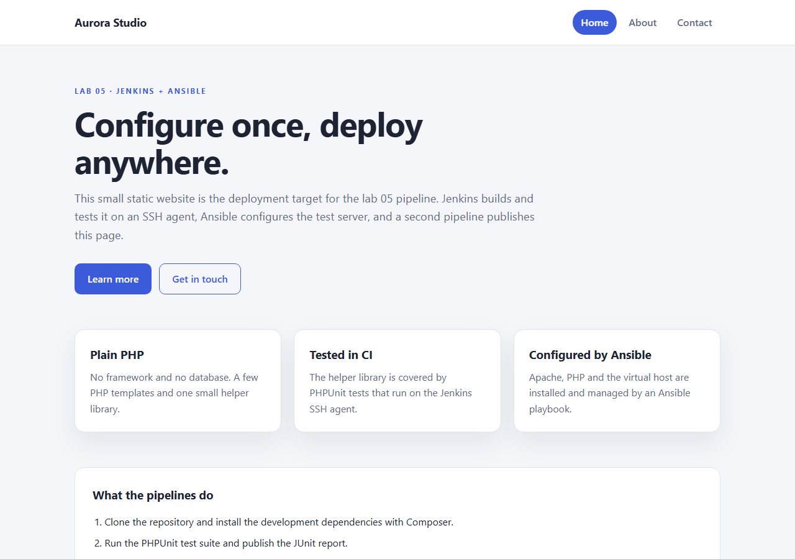

# Lab #5 — Automating server configuration with Ansible

## Project description

This is the individual work **IW05** of the *Automation and Scripting* course. The goal is to
automate the configuration of a test server with **Ansible** and to integrate that automation
into **Jenkins** pipelines.

The lab builds on IW04. The Jenkins controller and the SSH build agent are carried over from the
previous work, and the environment is extended with two new services:

- **ansible-agent** — a Jenkins SSH build agent that has Ansible installed and acts as the Ansible
  control node;
- **test-server** — an Ubuntu container with `openssh-server` that is configured only through
  Ansible playbooks.

The deployed application is a small static PHP website called **Aurora Studio**. It has three
pages, one helper library and a PHPUnit test suite. It deliberately has **no database and no
framework**, so the lab focuses on server configuration and CI/CD rather than on application code.

> This is a university lab running on a disposable local environment, not a production setup.
> Secrets are excluded from Git, host key verification is relaxed only for the throw-away test
> server, and extra SSH ports are published to the host for debugging. These trade-offs are listed
> in [Notes and limitations](#notes-and-limitations).

### Services

| Service | Image / build | Purpose | Host port |
| --- | --- | --- | --- |
| `jenkins-controller` | `jenkins/jenkins:lts` | Jenkins controller and web UI | `8080`, `50000` |
| `ssh-agent` | `Dockerfile.ssh_agent` | Jenkins agent for building and testing PHP | `2222` → 22 |
| `ansible-agent` | `Dockerfile.ansible_agent` | Jenkins agent that runs Ansible playbooks | `2223` → 22 |
| `test-server` | `Dockerfile.test_server` | Ubuntu server configured by Ansible, hosts Apache + PHP | `2224` → 22, `8081` → 80 |

After a successful deployment the site is available at <http://localhost:8081/>.

## Architecture

```text
Browser
   │
   ├── http://localhost:8080 ──> jenkins-controller
   │                                │
   │                                ├── SSH (22, jenkins-network) ──> ssh-agent
   │                                │                                   PHP 8.4, Composer, PHPUnit
   │                                │
   │                                └── SSH (22, jenkins-network) ──> ansible-agent
   │                                                                    Ansible control node
   │                                                                        │
   │                                                                        │ SSH as "ansible"
   │                                                                        ▼
   └── http://localhost:8081 ────────────────────────────────────────> test-server
                                                                        Apache 2.4 + PHP 8.3
```

Jenkins reaches both agents by their DNS names inside the `jenkins-network` Docker network. The
Ansible agent reaches the test server as the unprivileged `ansible` user with a dedicated SSH key.
The Apache document root is `/var/www/html`, and port `80` of the test server is published as
`8081` on the host.

## Repository structure

| Path | Purpose |
| --- | --- |
| `compose.yaml` | Defines all four services, the network, volumes and the Ansible private-key secret. |
| `Dockerfile.ssh_agent` | PHP build agent: PHP CLI, PHPUnit extensions, Composer and Git. |
| `Dockerfile.ansible_agent` | Ubuntu agent with OpenSSH server, JDK 21, Ansible, Git and rsync. |
| `Dockerfile.test_server` | Ubuntu server with OpenSSH server, Python and the `ansible` user. |
| `docker/ansible_agent_entrypoint.sh` | Installs the Jenkins public key and the test-server key, then starts `sshd`. |
| `docker/test_server_entrypoint.sh` | Installs the Ansible public key and starts `sshd` as PID 1. |
| `ansible/ansible.cfg` | Ansible defaults: inventory, no host key prompts, pipelining. |
| `ansible/hosts.ini` | Inventory with the `test-server` host and the `ansible` user. |
| `ansible/setup_test_server.yml` | Playbook that installs and configures Apache2 and PHP. |
| `ansible/deploy_php_app.yml` | Playbook that copies the site to the test server and verifies it. |
| `ansible/templates/php_site.conf.j2` | Apache virtual host template. |
| `app/` | The static PHP website and its PHPUnit tests. |
| `pipelines/php_build_and_test_pipeline.groovy` | Jenkins pipeline: checkout, Composer, PHPUnit, JUnit report. |
| `pipelines/ansible_setup_pipeline.groovy` | Jenkins pipeline: run `setup_test_server.yml`. |
| `pipelines/php_deploy_pipeline.groovy` | Jenkins pipeline: run `deploy_php_app.yml` and verify the site. |
| `secrets/` | SSH key pairs. **Not committed to Git.** |
| `.env` | Public keys passed to the containers. **Not committed to Git.** |
| `.env.example` | Example of the required variables. |
| `assets/` | Screenshots used in this report. |

## 1. Jenkins controller

The controller keeps the same role as in IW04. It is declared in `compose.yaml`:

```yaml
jenkins-controller:
  image: jenkins/jenkins:lts
  container_name: jenkins-controller
  ports:
    - "8080:8080"
    - "50000:50000"
  volumes:
    - jenkins_home:/var/jenkins_home
  networks:
    - jenkins-network
```

Start the stack and read the initial administrator password:

```bash
docker compose up -d --build
docker compose ps
docker exec jenkins-controller cat /var/jenkins_home/secrets/initialAdminPassword
```

The password is also printed in the container log:

```bash
docker logs jenkins-controller
```

After opening <http://localhost:8080>, the setup wizard is completed: the suggested plugins are
installed and the administrator account is created. The following plugins are installed
additionally because they are required by this lab:

- **Docker** — Docker CLI/API integration;
- **Docker Pipeline** — `agent { docker { ... } }` support;
- **GitHub Integration** — GitHub repository integration for pipeline jobs;
- **SSH Agent** — injects SSH credentials into builds;
- **JUnit** — publishes the PHPUnit XML report.

The `jenkins_home` named volume keeps jobs, credentials, plugins and build history between
container restarts.

The controller is then ready. The SSH host keys of both build agents are pre-seeded so that
Jenkins can verify them when the nodes are created:

```bash
docker exec jenkins-controller sh -c "
  mkdir -p /var/jenkins_home/.ssh
  ssh-keyscan -H ssh-agent ansible-agent >> /var/jenkins_home/.ssh/known_hosts
  chown -R jenkins:jenkins /var/jenkins_home/.ssh
  chmod 700 /var/jenkins_home/.ssh
"
```

## 2. SSH agent

The SSH agent is a Jenkins build agent for PHP. Three key pairs are generated for the lab:

```bash
ssh-keygen -t ed25519 -N "" -C "jenkins@controller -> ssh-agent"      -f secrets/jenkins_ssh_agent_key
ssh-keygen -t ed25519 -N "" -C "jenkins@controller -> ansible-agent"  -f secrets/jenkins_ansible_agent_key
ssh-keygen -t ed25519 -N "" -C "ansible@ansible-agent -> test-server" -f secrets/ansible_test_server_key
```

The public keys are placed in `.env`. Only public keys are stored there; the private keys stay in
`secrets/`, which is ignored by Git:

```dotenv
JENKINS_AGENT_SSH_PUBKEY="ssh-ed25519 AAAA... jenkins@controller"
ANSIBLE_AGENT_SSH_PUBKEY="ssh-ed25519 AAAA... jenkins@controller"
TEST_SERVER_ANSIBLE_PUBKEY="ssh-ed25519 AAAA... ansible@ansible-agent"
```

`Dockerfile.ssh_agent` extends the official `jenkins/ssh-agent` image and adds everything the PHP
build needs:

```dockerfile
FROM composer:2 AS composer

FROM jenkins/ssh-agent

RUN apt-get update && apt-get install -y --no-install-recommends \
        php-cli \
        php-mbstring \
        php-xml \
        php-zip \
        php-curl \
        unzip \
        git \
    && rm -rf /var/lib/apt/lists/*

COPY --from=composer /usr/bin/composer /usr/local/bin/composer
```

The extensions are required by Composer and PHPUnit: `php-xml` provides DOM/XMLWriter,
`php-mbstring` is used by PHPUnit, `php-zip` lets Composer unpack archives and `php-curl` speeds up
package downloads.

The service is defined in `compose.yaml`:

```yaml
ssh-agent:
  build:
    context: .
    dockerfile: Dockerfile.ssh_agent
  container_name: ssh-agent
  environment:
    - JENKINS_AGENT_SSH_PUBKEY=${JENKINS_AGENT_SSH_PUBKEY}
  ports:
    - "2222:22"
  volumes:
    - ssh_agent_volume:/home/jenkins/agent
  depends_on:
    - jenkins-controller
  networks:
    - jenkins-network
```

In Jenkins, the agent is registered once:

1. **Manage Jenkins → Credentials → System → Global credentials → Add Credentials**
   - Kind: `SSH Username with private key`
   - ID: `jenkins-ssh-agent`
   - Username: `jenkins`
   - Private key: contents of `secrets/jenkins_ssh_agent_key`.
2. **Manage Jenkins → Nodes → New Node**
   - Name: `ssh-agent1`
   - Type: `Permanent Agent`
   - Label: `php-agent`
   - Remote root directory: `/home/jenkins/agent`
   - Launch method: `Launch agents via SSH`
   - Host: `ssh-agent`, Port: `22`
   - Credentials: `jenkins-ssh-agent`

The node comes online because the controller already trusts the agent host key.

## 3. Ansible agent

The Ansible agent is a regular Jenkins SSH agent, but its image is based on Ubuntu and contains
Ansible. `Dockerfile.ansible_agent` installs the SSH server, a JRE for the Jenkins remoting agent,
Ansible, Git and rsync:

```dockerfile
FROM ubuntu:24.04

RUN apt-get update && apt-get install -y --no-install-recommends \
        ansible \
        ca-certificates \
        curl \
        git \
        openjdk-21-jre-headless \
        openssh-client \
        openssh-server \
        python3 \
        rsync \
        unzip \
    && rm -rf /var/lib/apt/lists/*
```

A dedicated `jenkins` user (UID/GID `1001`, avoiding the `ubuntu` user from the base image) owns
`/home/jenkins`, including the Jenkins remote root `/home/jenkins/agent`. The container does not use
the `jenkins/ssh-agent` entrypoint, so `docker/ansible_agent_entrypoint.sh` performs its job:

- installs `JENKINS_AGENT_SSH_PUBKEY` as `/home/jenkins/.ssh/authorized_keys`;
- copies the Ansible private key from `/run/secrets/ansible_test_server_key` to
  `/home/jenkins/.ssh/id_test_server` with mode `0600` and owner `jenkins`;
- writes an SSH config entry for `test-server`;
- generates host keys and starts `sshd -D`.

The key copy is important: Compose mounts secrets read-only and owned by root, and OpenSSH refuses
private keys with too-open permissions. The entrypoint creates a private, correctly owned copy.

The agent has its own key pair for Jenkins (`secrets/jenkins_ansible_agent_key`) and a separate key
pair for the test server (`secrets/ansible_test_server_key`). In Jenkins:

1. Create the credential `jenkins-ansible-agent` (username `jenkins`, private key
   `secrets/jenkins_ansible_agent_key`).
2. Create the node `ansible-agent1`:
   - Label: `ansible-agent`
   - Remote root directory: `/home/jenkins/agent`
   - Launch method: `Launch agents via SSH`
   - Host: `ansible-agent`, Port: `22`
   - Credentials: `jenkins-ansible-agent`

The `ansible_test_server_key` secret is declared in `compose.yaml` and mounted only into this
container:

```yaml
ansible-agent:
  build:
    context: .
    dockerfile: Dockerfile.ansible_agent
  environment:
    - JENKINS_AGENT_SSH_PUBKEY=${ANSIBLE_AGENT_SSH_PUBKEY}
  secrets:
    - ansible_test_server_key
  depends_on:
    - jenkins-controller
    - test-server
```

## 4. Test server

`Dockerfile.test_server` starts from Ubuntu 24.04 and installs only the minimum needed to be
managed by Ansible:

```dockerfile
FROM ubuntu:24.04

RUN apt-get update && apt-get install -y --no-install-recommends \
        ca-certificates \
        openssh-server \
        python3 \
        python3-apt \
        rsync \
        sudo \
    && rm -rf /var/lib/apt/lists/*
```

`python3` is required because Ansible modules are executed as Python programs on the managed host,
and `python3-apt` is required by the `apt` module. Apache and PHP are deliberately **not** part of
the image: they are installed by the playbook, which is the point of the exercise.

The `ansible` user is created with a home directory and passwordless sudo:

```dockerfile
RUN useradd -m -u 1001 -s /bin/bash -d /home/ansible ansible \
    && usermod -aG sudo ansible \
    && printf 'ansible ALL=(ALL) NOPASSWD:ALL\n' > /etc/sudoers.d/ansible \
    && chmod 0440 /etc/sudoers.d/ansible
```

`docker/test_server_entrypoint.sh` writes `TEST_SERVER_ANSIBLE_PUBKEY` (the public part of
`secrets/ansible_test_server_key`) to `/home/ansible/.ssh/authorized_keys`, generates the SSH host
keys and starts `sshd` as PID 1. Password authentication and root login are disabled in
`/etc/ssh/sshd_config.d/99-lab.conf`.

A `policy-rc.d` script that returns `101` prevents `apt` from trying to start services during image
builds and playbook runs; Ansible starts Apache explicitly through the `service` module.

The container publishes port `80` as `8081` so the deployed site can be opened from the host.

## 5. Ansible playbooks

### Inventory

`ansible/hosts.ini` describes the only managed host:

```ini
[test_servers]
test-server ansible_host=test-server ansible_user=ansible ansible_ssh_private_key_file=/home/jenkins/.ssh/id_test_server

[test_servers:vars]
ansible_python_interpreter=/usr/bin/python3
ansible_ssh_common_args=-o StrictHostKeyChecking=no -o UserKnownHostsFile=/dev/null
```

`ansible/ansible.cfg` disables interactive host key confirmation for the disposable container,
enables SSH pipelining and points to the inventory.

### `setup_test_server.yml`

The playbook runs with `become: true` and performs the following tasks:

| Task | Module | Result on the test server |
| --- | --- | --- |
| Update the apt cache | `ansible.builtin.apt` | Fresh package index, cached for an hour |
| Install Apache2 and PHP | `ansible.builtin.apt` | `apache2`, `libapache2-mod-php`, `php`, `php-mbstring`, `php-xml`, `php-curl`, `php-zip`, `unzip` |
| Create the document root | `ansible.builtin.file` | `/var/www/html` owned by `www-data` |
| Install the virtual host | `ansible.builtin.template` | `/etc/apache2/sites-available/000-default.conf` from `templates/php_site.conf.j2` |
| Enable rewriting | `ansible.builtin.apache2_module` | `rewrite` module enabled |
| Ensure Apache is running | `ansible.builtin.service` | Apache started through the SysV init script |
| Smoke test | `ansible.builtin.uri` | `http://127.0.0.1/` returns HTTP 200 |

The virtual host sets `DocumentRoot /var/www/html`, allows `.htaccess` overrides and prefers
`index.php` over `index.html`. Both tasks that change Apache configuration notify the
`Restart Apache` handler, so the server is restarted only when something actually changed.

Run it from the Ansible agent:

```bash
cd lab05
ansible-playbook -i ansible/hosts.ini ansible/setup_test_server.yml
```

Result of the first run:

```text
PLAY RECAP *********************************************************************
test-server : ok=9    changed=7    unreachable=0    failed=0    skipped=0    rescued=0    ignored=0
```

A second run reports `changed=0`, which demonstrates Ansible idempotence: all packages are already
present and the configuration matches the desired state.

### `deploy_php_app.yml`

The deployment playbook copies the site and verifies the result:

| Task | Module | Result |
| --- | --- | --- |
| Check Apache | `ansible.builtin.stat` | Fails early with a clear message if the setup playbook has not run |
| Copy site files | `ansible.builtin.copy` | `index.php`, `about.php`, `contact.php`, `includes/`, `assets/`, `src/` copied to `/var/www/html` |
| Fix ownership | `ansible.builtin.file` | Everything owned by `www-data:www-data` |
| Restart Apache | `ansible.builtin.service` | New files are served |
| Verify the page | `ansible.builtin.uri` | HTTP 200 and the page title is printed |

The playbook is run with the path to the checked-out project, so the same playbook works for a
manual run and for a Jenkins build:

```bash
ansible-playbook -i ansible/hosts.ini ansible/deploy_php_app.yml \
  -e "project_dir=$WORKSPACE/automation/lab05/app"
```

The deployment run reported:

```text
TASK [Copy the site files to the document root] ********************************
changed: [test-server] => (item=index.php)
changed: [test-server] => (item=about.php)
...
TASK [Show the deployed page title] ********************************************
ok: [test-server] => {
    "msg": "Deployed page: Home &middot; Aurora Studio"
}

PLAY RECAP *********************************************************************
test-server : ok=7    changed=3    unreachable=0    failed=0    skipped=0    rescued=0    ignored=0
```

## 6. Jenkins pipelines

The pipeline scripts are stored in `pipelines/`. For each job, create a **Pipeline** job in
Jenkins, enable **This project is parameterized** only if the defaults need to be changed, and
paste the corresponding script into the pipeline definition (or point *Pipeline script from SCM* to
the `lab05/pipelines/*.groovy` file in the repository).

All jobs clone the public repository <https://github.com/gausatereduard/automation> over HTTPS, so
no GitHub credentials are required.

### 6.1 Build and test the PHP project

`pipelines/php_build_and_test_pipeline.groovy` runs on the `php-agent` label and contains five
stages:

1. **Checkout** — clones the repository into `automation`;
2. **Environment** — prints the PHP and Composer versions;
3. **Install Dependencies** — runs `composer install` in `automation/lab05/app`;
4. **Run Unit Tests** — runs `vendor/bin/phpunit --log-junit build/junit.xml`;
5. **Archive Results** — archives the JUnit XML and publishes it with the `junit` step.

Key part of the pipeline:

```groovy
stage('Run Unit Tests') {
    steps {
        dir('automation/lab05/app') {
            sh 'vendor/bin/phpunit --log-junit build/junit.xml'
        }
    }
}

post {
    always {
        junit allowEmptyResults: true, testResults: 'automation/lab05/app/build/junit.xml'
    }
}
```

The same commands were executed on the SSH agent during the verification:

```text
PHPUnit 11.5.58 by Sebastian Bergmann and contributors.

Runtime:       PHP 8.4.27
Configuration: /home/jenkins/app/phpunit.xml.dist

...........                                                       11 / 11 (100%)

OK (11 tests, 21 assertions)
```

The test suite covers the helper library: page titles, navigation rendering, the active-page
marker, HTML escaping, date formatting and the footer text. Because the site has no database, the
tests are fast and completely isolated.

### 6.2 Configure the test server

`pipelines/ansible_setup_pipeline.groovy` runs on the `ansible-agent` label:

1. **Checkout** — clones the repository;
2. **Check Ansible** — prints the Ansible version;
3. **Configure Test Server** — runs
   `ansible-playbook -i ansible/hosts.ini ansible/setup_test_server.yml`.

The playbook connects to `test-server` as `ansible` using
`/home/jenkins/.ssh/id_test_server` and applies the Apache/PHP configuration described above.

### 6.3 Deploy the PHP project

`pipelines/php_deploy_pipeline.groovy` also runs on the `ansible-agent` label:

1. **Checkout** — clones the repository that contains both the playbook and the site;
2. **Deploy to Test Server** — runs `deploy_php_app.yml` with
   `project_dir=$WORKSPACE/automation/lab05/app`;
3. **Verify Deployment** — runs `curl -fsS http://test-server/ | grep -q 'Aurora Studio'` from the
   agent.

The last stage is a quick smoke test executed outside Ansible: it proves that the published port
and the copied files work from another container, not only from the server itself.

The three jobs are run in this order: **build and test → configure test server → deploy**. The
configuration job is idempotent, so it can be re-run at any time before a deployment.

## 7. Deployed site

After the deployment playbook finishes, the test server answers on the published port:

```text
/                -> 200 (2617 bytes)
/about.php       -> 200 (2308 bytes)
/contact.php     -> 200 (1871 bytes)
/assets/style.css -> 200 (4707 bytes)
```



The page is served by Apache 2.4.58 with PHP 8.3.6 on the test server. Apache and PHP were installed
exclusively by the Ansible playbook; the test server image itself does not contain them.

## 8. Answers to the control questions

### 8.1 What are the advantages of using Ansible for server configuration?

- **Agentless** — Ansible only needs SSH and Python on the managed host; there is no daemon or
  agent to install, upgrade or monitor.
- **Idempotence** — modules describe the desired state. Re-running a playbook does not repeat work
  that is already done; the second run of `setup_test_server.yml` reported `changed=0`.
- **Declarative and readable** — YAML playbooks are easy to review, version in Git and discuss with
  people who are not full-time administrators.
- **Push-based and immediate** — a playbook runs when it is invoked, which fits CI/CD pipelines
  naturally; no waiting for a periodic configuration run.
- **Inventory and variables** — hosts can be grouped, and the same playbook can target development,
  staging and production with different variables.
- **Large module library** — packages, services, users, files, templates, containers, cloud
  resources and databases are all handled by dedicated modules.
- **Reusable building blocks** — roles, collections and handlers keep playbooks small and
  maintainable.
- **Dry runs** — `--check` and `--diff` show what would change before anything is modified.
- **Predictable environments** — the same playbook creates the same server configuration every
  time, which removes manual steps and configuration drift.
- **Good CI/CD integration** — a Jenkins agent can run Ansible the same way a human does, without
  extra infrastructure.

### 8.2 What other Ansible modules exist for configuration management?

Ansible ships with a very large module library. The most relevant groups are:

- **Packages** — `apt`, `dnf`, `yum`, `zypper`, `package` (generic), `snap`, `pip`, `npm`.
- **Services** — `service`, `systemd`, `sysvinit`, `supervisorctl`.
- **Files and templates** — `copy`, `template`, `file`, `fetch`, `synchronize`, `unarchive`,
  `get_url`, `lineinfile`, `blockinfile`, `replace`.
- **Users and access** — `user`, `group`, `authorized_key`, `known_hosts`, `sudoers` (collection).
- **Scheduling** — `cron`, `at`, `systemd_timer`.
- **Version control** — `git`, `subversion`.
- **Commands and checks** — `command`, `shell`, `script`, `raw`, `uri`, `wait_for`, `assert`,
  `fail`, `debug`, `set_fact`.
- **Databases** — `community.mysql`, `community.postgresql`, `community.mongodb` modules.
- **Containers and orchestration** — `community.docker.docker_container`,
  `community.docker.docker_compose_v2`, `kubernetes.core.k8s`.
- **Cloud** — `amazon.aws`, `azure.azure_rm`, `google.cloud`.
- **Networking** — `ansible.netcommon` and vendor-specific network collections.
- **System facts and tuning** — `setup`, `hostname`, `timezone`, `locale`, `mount`, `modprobe`,
  `sysctl`.

This lab uses only a small subset (`apt`, `file`, `template`, `service`, `copy`, `uri`, `stat`,
`assert`, `debug`, `apache2_module`), but the same structure scales to much larger roles.

### 8.3 What problems did you encounter when creating the Ansible playbook and how did you solve them?

1. **The Ansible private key could not be used directly from the Compose secret.**
   Compose mounts secrets read-only and owned by `root`, and SSH rejects a private key with
   permissive ownership. The agent entrypoint copies the key to `/home/jenkins/.ssh/id_test_server`
   with mode `0600` and owner `jenkins` before starting `sshd`.

2. **Ansible could not find Python on the managed host.**
   The `apt` module requires `python3-apt` on Ubuntu, not just `python3`. The package was added to
   `Dockerfile.test_server`, and the inventory pins
   `ansible_python_interpreter=/usr/bin/python3`.

3. **Apache was not installed or running after the container started.**
   This is intentional: the image contains only SSH, and the playbook installs Apache. Because the
   container has no systemd, the `service` module falls back to the SysV init script and starts
   Apache correctly. A `policy-rc.d` stub prevents `apt` from trying to start services during
   installation.

4. **The test server's SSH host keys change when the container is recreated.**
   Jenkins needs a stable `known_hosts`, but the test server is disposable. The lab disables host
   key checking for the test-server connection in `ansible.cfg`/`ansible_ssh_common_args`. For the
   Jenkins agents, which are long-lived nodes from Jenkins' point of view, host keys are added with
   `ssh-keyscan` and verification stays enabled.

5. **The PHP build agent has PHP 8.4, while PHPUnit 10.5 only supports PHP 8.1–8.3.**
   The project was updated to `phpunit/phpunit ^11.5`, which supports PHP 8.2–8.4, and the tests
   were executed successfully on PHP 8.4.27.

6. **Composer warned that the PHP cURL extension was missing.**
   Composer still worked, but downloads were slower. `php-curl` was added to
   `Dockerfile.ssh_agent`, and the agent image was rebuilt.

7. **The first `composer install` failed with `getaddrinfo for repo.packagist.org failed`.**
   Docker Desktop had just started and its internal DNS resolver was not ready. `getent hosts
   github.com` worked a moment later, and the same command succeeded on retry. No configuration
   change was needed.

8. **Container names from IW04 conflicted with the new stack.**
   The old `jenkins-controller` and `ssh-agent` containers were still present (stopped) from the
   previous lab. They were removed with `docker rm -f`, while their named volumes were kept, so
   the new `lab05` project started without name conflicts.

## 9. Conclusion

The lab produced a fully containerised environment in which Jenkins delegates PHP builds and
Ansible runs to separate SSH agents. The Ansible agent configures an Ubuntu test server from
scratch — Apache, PHP, modules and the virtual host — and a second playbook deploys the static
site. The test server image contains no application software at all, which makes the division
between *infrastructure configuration* and *application deployment* explicit.

The Ansible playbook is idempotent, the PHP project is covered by PHPUnit tests that run on the
build agent, and the deployment is verified by an HTTP check. The main integration problems were
SSH key handling inside containers, the absence of systemd in the test server container, and host
key verification between disposable containers. All of them were solved with small, explicit
configuration steps.

## Notes and limitations

- This is a disposable university lab. Host key verification is disabled **only** for the
  test-server connection; the Jenkins agents keep verified host keys in
  `/var/jenkins_home/.ssh/known_hosts`.
- SSH ports `2222`, `2223` and `2224` are published to the host for debugging. In a real
  environment only the application port would be exposed.
- The controller, agents and test server share one Docker bridge network. A production setup would
  separate management and application networks and restrict SSH with firewall rules.
- `secrets/` and `.env` are ignored by Git. `.env` contains only public keys; private keys never
  leave the machine.

## Submission

Repository: <https://github.com/gausatereduard/automation/tree/main/lab05>

Jenkins: <http://localhost:8080>

Deployed site: <http://localhost:8081>
